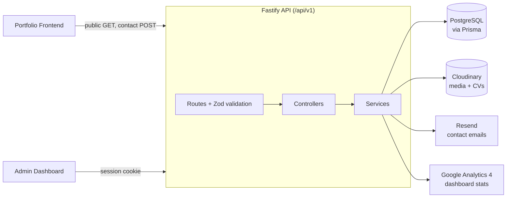

<div align="center">

# Portfolio Backend

**A secure, type-safe REST API** that powers my portfolio website and its admin dashboard.


</div>

---

## Overview

This API stores and serves all portfolio content (projects, skills, experience, education, certificates, CVs, site settings and contact messages). Public endpoints feed the [portfolio website](https://github.com/ElangoSugikaran/portfoilio-frontend). Admin endpoints, protected by cookie-based sessions, feed the [admin dashboard](https://github.com/ElangoSugikaran/admin-dashboard-frontend).

## Architecture



Each feature is a self-contained module following **route → schema → controller → service**:

```text
src/
├── modules/        # about, auth, certificates, cv, dashboard, education,
│                   # experience, media, messages, project, settings, skills
├── plugins/        # prisma, auth, rate limit, swagger, error handler
├── routes/admin/   # single authenticated router for all admin endpoints
├── services/       # Cloudinary, email (Resend), media assets, GA4 analytics
├── config/env.ts   # Zod-validated environment variables
└── lib/            # shared errors, response helpers
prisma/             # schema + SQL migrations
```

## Features

- **Public API** for projects, skills, experience, education, certificates, about, settings and CV download
- **Admin API** with full CRUD for every content type, drag-reorder for education, draft/hidden content, and a dashboard overview
- **Media management**: image, video and PDF upload to Cloudinary (10 MB limit) with safe delete
- **CV manager**: upload multiple PDFs, mark one as primary, download as `application/pdf`
- **Contact form**: messages saved to the database and emailed through Resend
- **Analytics**: optional Google Analytics 4 data on the admin dashboard
- **Interactive API docs**: Swagger UI at `/api/v1/docs` (development only)

## Security

| Area | Implementation |
|---|---|
| Authentication | Random session token in an **HttpOnly cookie**; only its **SHA-256 hash** is stored in the database |
| Sessions | 8-hour maximum lifetime and 30-minute idle timeout, with expired sessions deleted |
| Passwords | Hashed with bcrypt |
| Admin routes | One router-level auth hook, so a new admin route cannot be left unprotected |
| CSRF | State-changing admin requests must come from an allow-listed `ADMIN_ORIGINS` origin |
| CORS | Explicit origin allow-list, required in production |
| Rate limiting | 100 requests/min per IP globally; login limited to 5 attempts per 15 min; contact form limited to 5/min |
| Headers | Helmet security headers (CSP enabled in production) |
| Validation | Every request validated with Zod |
| Logging | Cookies, authorization headers and passwords are redacted from logs |
| Caching | Admin responses sent with `Cache-Control: no-store` |

## API Overview

Base path: `/api/v1`

| Group | Public | Admin (`/admin/...`) |
|---|---|---|
| Projects | `GET /projects`, `GET /projects/:id` | CRUD, include drafts |
| Skills | `GET /skills` | CRUD |
| Experience | `GET /experience` | CRUD |
| Education | `GET /education` | CRUD, reorder |
| Certificates | `GET /certificates` | CRUD |
| About and Settings | `GET /about`, `GET /settings` | Update |
| CV | `GET /about/cv/download/:id` | Upload, replace, set primary, delete, download |
| Messages | `POST /messages` | List, read, update status, delete |
| Media | n/a | Upload, delete |
| Auth | n/a | `POST /admin/auth/login`, `POST /admin/auth/logout`, profile, change password |
| Dashboard | n/a | `GET /admin/dashboard` |

Health checks: `GET /health` (liveness) and `GET /health/ready` (database check).
Full request and response schemas are in the Swagger UI.

## Getting Started

**Prerequisites:** Node.js 20.19+ (22 LTS recommended), a PostgreSQL database (such as [Neon](https://neon.tech)), a [Cloudinary](https://cloudinary.com) account and a [Resend](https://resend.com) API key.

```bash
# 1. Install dependencies
npm install

# 2. Configure environment
cp .env.example .env     # then fill in the values below

# 3. Apply database migrations and generate the Prisma client
npx prisma migrate deploy
npx prisma generate

# 4. Start the dev server (http://localhost:8000)
npm run dev
```

### Environment variables

| Variable | Required | Description |
|---|---|---|
| `DATABASE_URL` | Yes | PostgreSQL connection string |
| `DIRECT_URL` | No | Direct (non-pooled) connection used for migrations |
| `CLOUDINARY_URL` | Yes | `cloudinary://...` credentials |
| `RESEND_API_KEY` | Yes | API key for sending contact emails |
| `CONTACT_EMAIL_TO` | Yes | Inbox that receives contact messages |
| `CORS_ORIGINS` | Production | Comma-separated allowed frontend origins |
| `ADMIN_ORIGINS` | Production | Origin(s) of the admin dashboard (must also be in `CORS_ORIGINS`) |
| `PORT` | No | Defaults to `8000` |
| `NODE_ENV` | No | `development`, `production` or `test` |
| `GA4_PROPERTY_ID`, `GA4_CLIENT_EMAIL`, `GA4_PRIVATE_KEY` | No | Set all three or none, to enable GA4 analytics |

### Scripts

| Command | Description |
|---|---|
| `npm run dev` | Start with hot reload (`tsx watch`) |
| `npm run build` | Generate Prisma client and compile TypeScript to `dist/` |
| `npm start` | Run the compiled server |

## Data Model

Main Prisma models: `Admin`, `AdminSession`, `Media`, `Project` (with `ProjectCategory`, `ProjectMedia`, `ProjectPhase`), `Technology`, `Experience`, `Education`, `Certificate`, `Message`, `SiteSettings`, `SocialLink` and `ResumeDocument`. See [`prisma/schema.prisma`](prisma/schema.prisma).

## Deployment

Built to run on any Node host (for example Render). Set `NODE_ENV=production`, configure `CORS_ORIGINS` and `ADMIN_ORIGINS`, and point your uptime monitor at `/health`.

## Related Repositories

| Repo | Purpose |
|---|---|
| [portfoilio-frontend](https://github.com/ElangoSugikaran/portfoilio-frontend) | Public portfolio website |
| [admin-dashboard-frontend](https://github.com/ElangoSugikaran/admin-dashboard-frontend) | Private dashboard to manage all content |

## Author

**Elango Sugikaran**, Full Stack Software Engineer
[Portfolio](https://sugikaran-dev.netlify.app/) · [LinkedIn](https://www.linkedin.com/in/elango-sugikaran-75323a256/) · [GitHub](https://github.com/ElangoSugikaran)
